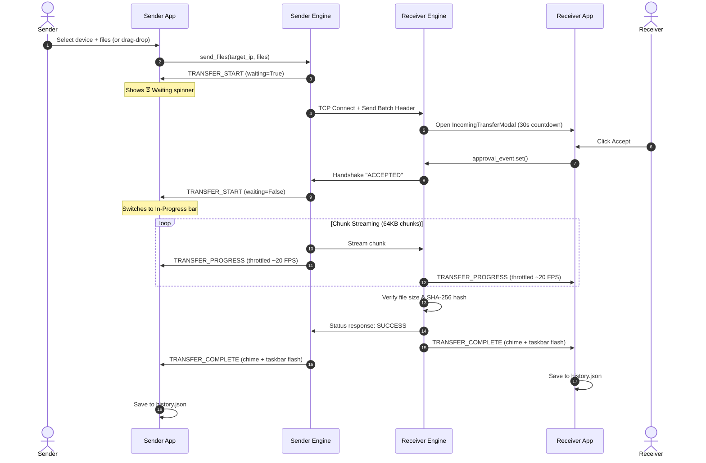

# AirDude - VS Code Inspired Local File Transfer App

> High-performance, AirDrop-style LAN file sharing for Windows, macOS, and Linux built with **Python + CustomTkinter**.
> Professional desktop interface inspired by **Visual Studio Code**. No internet required. No accounts. No cloud uploads.

---

## 🎨 VS Code-Inspired UI Architecture

The user interface follows a modern 3-column VS Code layout:

1. **Activity Bar (Far Left, 48px)**:
   - `⬡` **Nearby Devices** (Primary explorer)
   - `⇄` **Transfers** (Live transfer manager with Incoming, Outgoing, and Completed views)
   - `☰` **History** (Persistent logs with SHA-256 verification badges)
   - `⚙` **Settings** (Identity, theme, storage paths, active ports)
   - `↗` **Send Files Quick Action** (Jump directly to send workflow)

2. **Sidebar Explorer Panel (230px)**:
   - Dynamic section headers (`DISCOVERED PEERS`, `TRANSFER QUEUE`, `HISTORY LOGS`, `PREFERENCES`).
   - Live discovered LAN device list with quick-send actions.
   - Queue counts and active transfer sessions.

3. **Main Workspace**:
   - Clean top status bar showing breadcrumbs and local network connectivity.
   - Responsive workspace frames for Devices, Multi-file Send, Transfers, History, and Settings.

**Color Palette:**
- Background: `#1E1E1E`
- Sidebar: `#252526`
- Activity Bar: `#333333`
- Top/Bottom Panels: `#181818`
- Cards / Items: `#2D2D30`
- Borders / Dividers: `#3C3C3C`
- Primary Accent: `#007ACC` (VS Code Blue)
- Success: `#4EC9B0` | Warning: `#CCA700` | Error: `#F44747`

---

## How to Run

```bash
# Device 1 (e.g. laptop)
python app_ui.py --name "Bilal's Laptop" --udp_port 45454 --tcp_port 45455 --broadcast_port 45456

# Device 2 (e.g. office PC on the same Wi-Fi)
python app_ui.py --name "Office PC" --udp_port 45456 --tcp_port 45457 --broadcast_port 45454
```

### Automated Verification Test Suite

Run all unit, network streaming, cancellation, and UI tests:

```bash
python verify_suite.py
```

---

## Project Structure

| File | Purpose |
|------|---------|
| `app_ui.py` | Complete VS Code-inspired UI: Activity Bar, Sidebar, Workspace, Modals |
| `network.py` | UDP discovery + 64KB chunked TCP streaming engine + SHA-256 validation |
| `utils.py` | File hashing, formatters, JSON settings/history persistence, Win32 drag-drop |
| `verify_suite.py` | Automated unit & integration verification test suite |
| `settings.json` | Persistent user configuration (device name, theme, save path) |
| `history.json` | Persistent transfer log (auto-created, max 100 entries) |


---

## ✅ Completed Features & Architecture

### 🔵 Core Networking (`network.py`)

- **UDP Device Discovery**: Broadcasts device identity, OS, IP, TCP port, and unique UUID every 2s.
- **Device Deduplication**: UUID-based device keys prevent duplicate cards on multi-homed interfaces.
- **Localhost & Own IP Filtering**: Automatically ignores `127.0.0.1` and own local IPs.
- **Port Conflict Handling**: Gracefully detects if TCP or UDP ports are already occupied and reports cleanly.
- **TCP Batch File Transfer**: Streams multiple files over a single TCP connection with one handshake.
- **SHA-256 Hash Verification**: Computes cryptographic checksum before sending; receiver re-verifies on disk.
- **Live Receiver Progress Streaming**: Real-time progress events pushed during socket recv stream.
- **Receiver & Sender Progress Throttling**: Throttled to ~20 FPS (every ~256KB or 0.05s) to ensure zero UI lag.
- **Pause & Resume Transfer**: Live sender stream pause/resume via `threading.Event`.
- **Cancel Transfer**: Instant abort and socket cleanup.
- **30s Timeouts**:
  - Sender 30s socket timeout if receiver does not respond.
  - Receiver 30s auto-decline if popup modal is ignored.
- **Dynamic Device Renaming**: `set_hostname()` immediately announces new name over UDP.
- **Leak-Free Socket Cleanup**: Sockets closed in `finally` blocks.

### 🟣 UI / App (`app_ui.py`)

- **100ms Fast Event Polling**: Queue polling rate updated from 1000ms to 100ms for smooth 10 FPS live updates.
- **Native Explorer Drag & Drop**: Drag files directly from Windows Explorer into the app window (built using pure Python `ctypes`).
- **Complete Settings Page**:
  - **Editable Device Name**: Change device name live with "Save" button, immediately broadcasting to peers.
  - **Theme Selection**: Switch between "System", "Light", and "Dark" modes on the fly.
  - **Default Save Directory**: Browse and select custom download folder.
  - **Port Information**: Displays active network ports.
- **Settings Persistence**: Saves and loads all preferences from `settings.json`.
- **Transfer Notifications**: Subtle system chime (`winsound.MessageBeep`) and taskbar flash on transfer completion.
- **Robust Retry Button**: Failed cards retain target IP, port, peer name, and file path for reliable 1-click retry.
- **TransferCard States**:
  - **Waiting State**: Indeterminate animated spinner + "⏳ Waiting..." badge while peer reviews transfer.
  - **In Progress**: Real-time determinate bar with live speed calculation, Pause, and Cancel.
  - **Paused**: Amber badge; "▶ Resume" button.
  - **Completed**: Compact single-row list item with green checkmark and "SHA-256 Verified".
  - **Failed**: Red badge pill, clean error message, and "🔄 Retry" button.
- **IncomingTransferModal**:
  - Fixed 500x600 window centered on screen.
  - Live 30s countdown: *"Auto-declining in 30s..."*.
  - Proper timer cancellation on user click.
  - Save destination picker (Downloads/AirDude, Desktop, or custom folder).
- **Transfer History**:
  - Saved to `history.json` with 100-entry retention cap.
  - Survives app restarts and navigation tab switches.
  - "Clear History" button with confirmation prompt.
- **Mouse & Touchpad Scrolling**: `<MouseWheel>` and trackpad scroll bound globally.
- **Interactive Device Cards**: "Send Files" action button appears on hover.

---

## Transfer Flow (Sequence)



---

*Production verified: Python 3.10+ compatible on Windows/macOS/Linux.*
